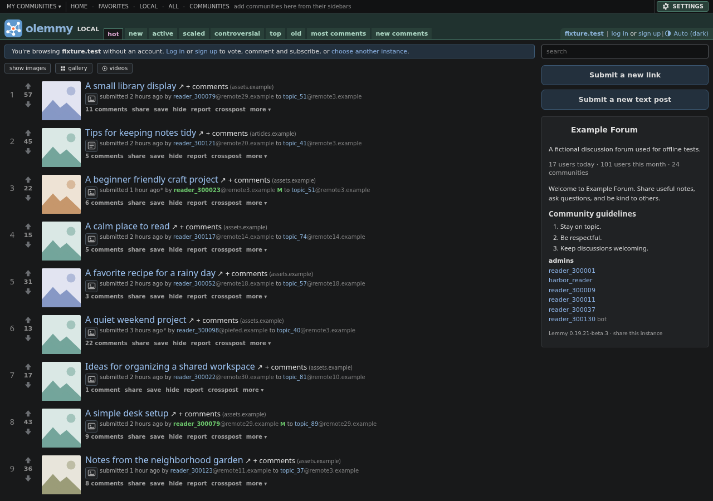
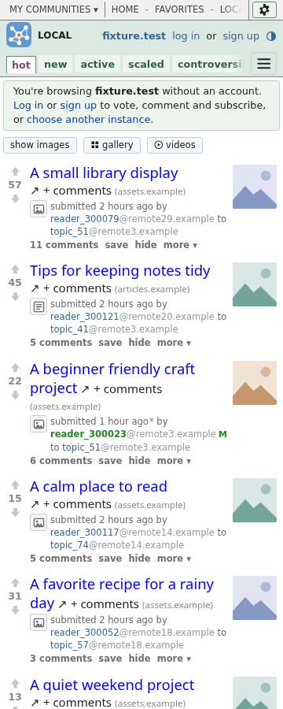
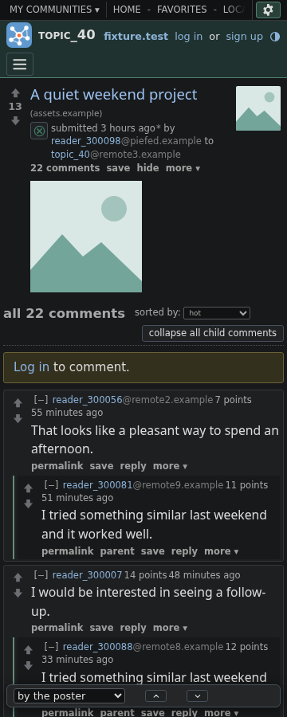

# Olemmy

[](https://github.com/wheresjames/olemmy/actions/workflows/site.yml)

**An old-school, information-dense web client for [Lemmy](https://join-lemmy.org/).** Lots of posts on one screen, vote arrows and thumbnails, nested comments, keyboard shortcuts, and no clutter.

### 👉 [Try it: wheresjames.github.io/olemmy](https://wheresjames.github.io/olemmy/)

Pick your instance and start reading. Nothing to install and no sign-up: Olemmy runs in your browser and talks straight to the Lemmy instance you choose.



<p align="center">
  
  &nbsp;
  
</p>

Screenshots use fictional posts and users from the offline test fixtures.

## What you get

- **Dense, text-first listings** with hot / new / top sorting, inline images and video, and a gallery and videos-only view
- **Nested comments** you can collapse, with new ones highlighted since your last visit
- **Keyboard navigation**: `j`/`k` to move, `a`/`z` to vote, `?` for the rest
- **Favorites**: star communities (logged in or not) and browse them a page at a time
- **Your own filters, user tags and shortcuts**, kept in your browser
- **Light, dark, black and high-contrast themes**, and a layout that works on phones
- **Share links that work for anyone**, whatever instance they use
- Several accounts, basic moderator tools, offline support, and installable as an app

## Run it yourself

It's plain static files: no framework and no build step needed.

```sh
npm run serve        # http://localhost:8000/ (it also prints an address for phones on your network)
```

Any static web server works; serve the `web/` folder.

## Develop

```sh
npm install          # test tools only (Playwright)
npm test             # unit tests
npx playwright test  # end-to-end tests in Chromium and Firefox
./scripts/build.sh   # a minified copy in dist/web
```

Every push runs the tests, and the default branch is deployed to GitHub Pages ([workflow](.github/workflows/site.yml)).

## License

[MIT](LICENSE). Uses [markdown-it](https://github.com/markdown-it/markdown-it) (MIT). Not affiliated with Lemmy.
